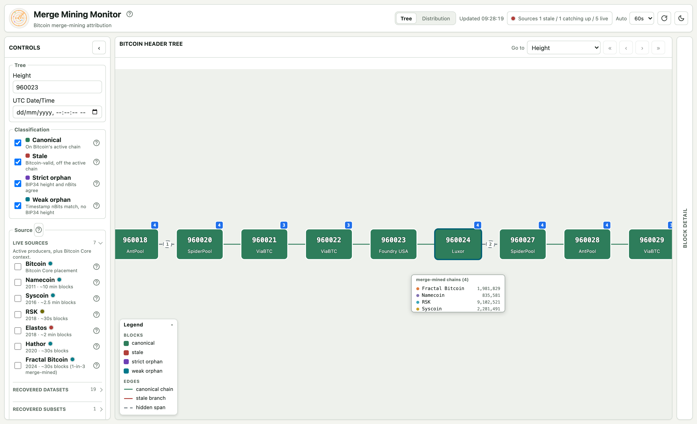
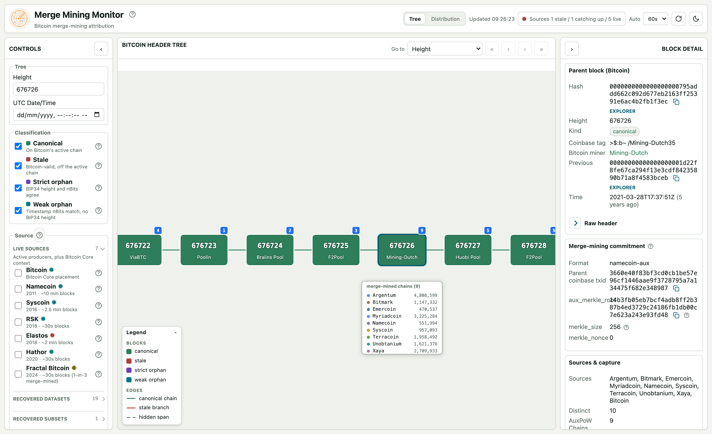
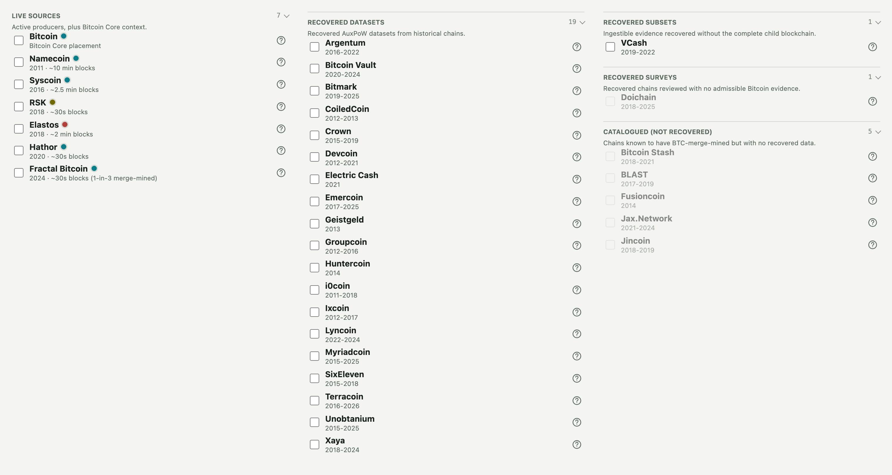
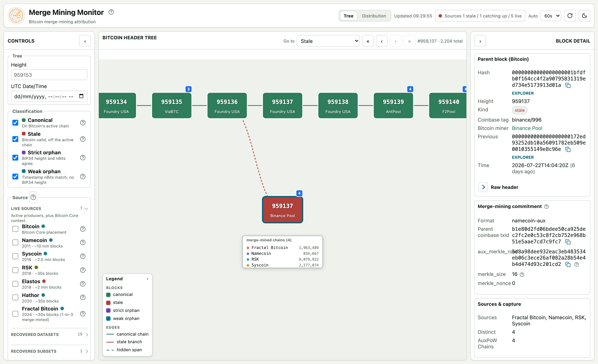
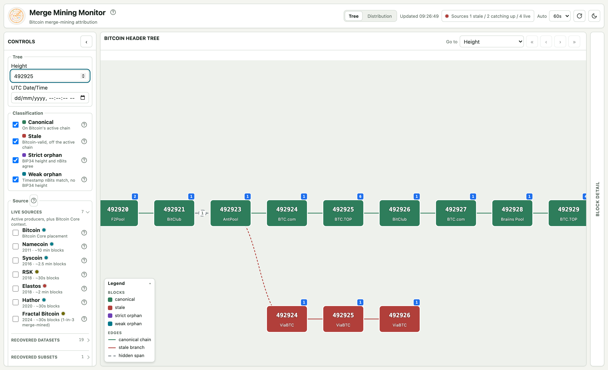
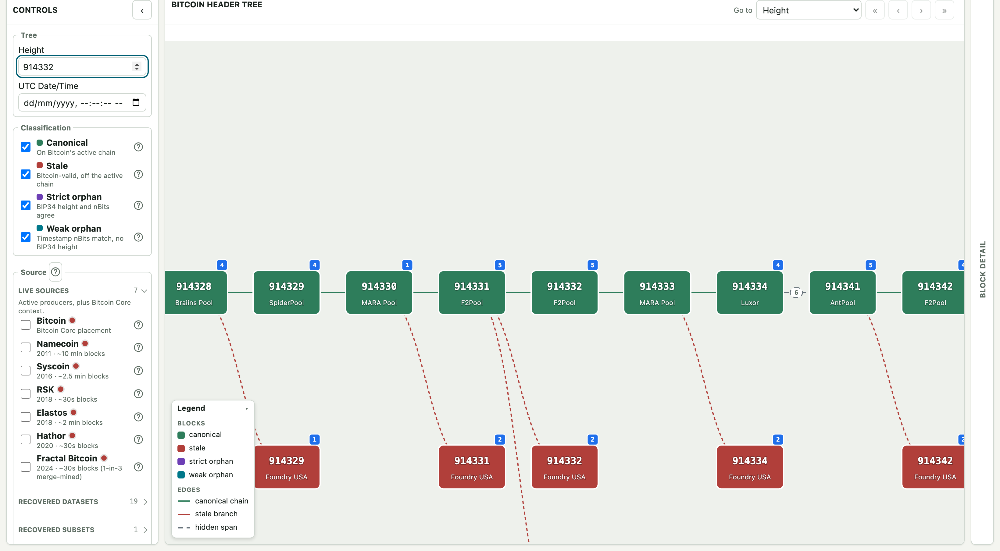
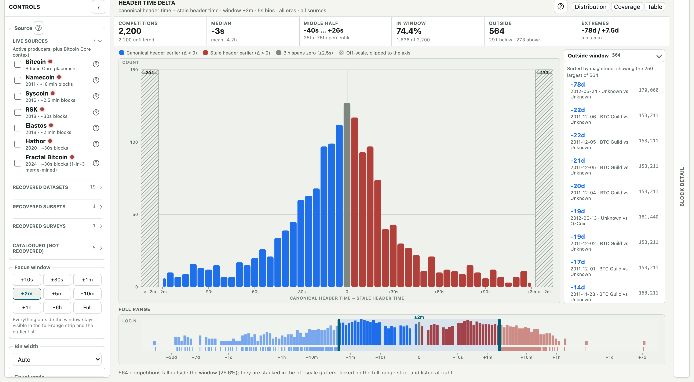
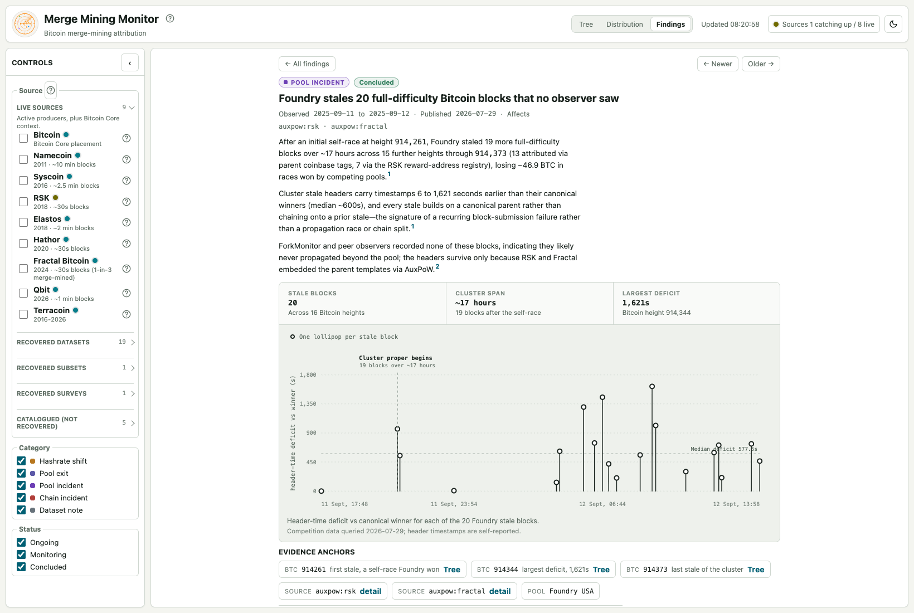
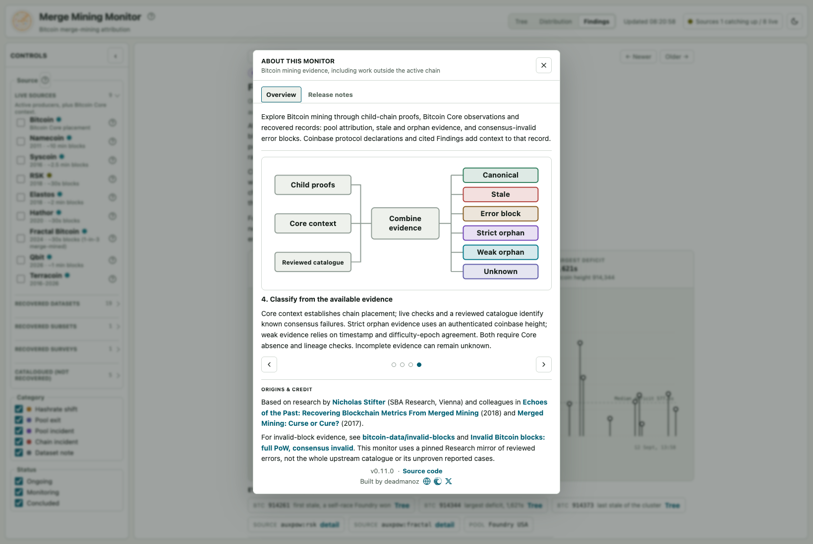

# Merge Mining Monitor

A live monitor and historical record of Bitcoin mining evidence: merge-mined chains, pool attribution, stale and orphan headers, consensus-invalid error blocks, and protocol declarations in Bitcoin coinbases.

[Open the live monitor](https://mmm.deadmanoz.xyz/) to explore the data.

> [!WARNING]
> This project is under active development. The database schema is likely to
> change before 1.0.0, and migrations may be consolidated for that release.
> A continuous in-place upgrade path is not guaranteed. Back up persistent
> data before upgrading and follow the release-specific upgrade instructions.

<picture>
  <source media="(prefers-color-scheme: dark)" srcset="docs/img/hero-dark.png" />
  
</picture>

Bitcoin's proof of work secures more than Bitcoin.
Merge-mined chains reuse it: a miner hashing a Bitcoin block can, at no extra work, commit that same proof to Namecoin, RSK, Syscoin, and dozens of other chains.
The Bitcoin block doesn't say which chains rode along, though.
That record lives on the child chains, where each merge-mined block holds an [AuxPoW proof](https://deadmanoz.xyz/posts/2026/merge-mining) pointing back at its Bitcoin block.

Merge Mining Monitor reconstructs it.
From live producers and recovered historical chains, it connects Bitcoin headers to available pool attribution and child-chain witnesses, and renders them alongside the canonical chain.
The recovery work behind the historical datasets lives in the companion [`merge-mining-research`](https://github.com/deadmanoz/merge-mining-research) repository.

Child-chain records can preserve Bitcoin work absent from the active chain, including stale branches and templates that violate Bitcoin consensus rules.
The monitor combines this evidence with Bitcoin Core observations and a reviewed error catalogue.
Historical coverage reaches back to 2011; the available evidence and classification limits are described below.

## Block and miner attribution

<picture>
  <source media="(prefers-color-scheme: dark)" srcset="docs/img/merge-mining-detail-dark.png" />
  
</picture>

*Block 676,726 (28 March 2021), mined by Mining-Dutch, carried the proof of work for nine merge-mined chains at once (Argentum, Bitmark, Emercoin, Myriadcoin, Namecoin, Syscoin, Terracoin, Unobtanium, and Xaya).
The Block Detail drawer resolves the pool, the decoded AuxPoW commitment, and each chain's child block.*

Bitcoin pool attribution comes from coinbase tags and payout addresses.
Child-chain identities use their own tags, reward addresses or miner fields, and remain separate from the Bitcoin parent pool.
Mappings can be unknown or carry different confidence levels; see [attribution](docs/attribution.md) for the chain-specific evidence, including Qbit's native payout registry.

The main view is a windowed Bitcoin header tree: the canonical spine, each block labelled with its pool, a badge for the number of chains that merge-mined it, and a second for the CORE and exSat declarations in its coinbase.
From it you can:

- **Browse synced chain windows**, from genesis to the current tip where the database has coverage, or jump to a height or UTC timestamp.
- **Inspect a block** in a detail drawer: the pool and miner, the decoded AuxPoW commitment, the observed child chains that merge-mined it, authenticated child height/hash/header/time/`nBits` evidence where available, and external explorer links.
- **Filter by source** to see which headers a given chain touched, and by classification to isolate canonical, stale, consensus-invalid error-block, or orphan evidence.
- **Step through the record** with a single navigator across the latest stale blocks, stale branches, consensus-invalid error blocks, orphans, and orphan branches.

## Protocol commitments

Some Bitcoin coinbases also declare accounts for Core DAO (CORE) or exSat.
These are protocol declarations, not additional merge-mined child chains.
The tree's second badge counts them; the block details show CORE validator/reward addresses and exSat synchronizer accounts, decoding status and available account associations.

A declaration does not establish who built the block, controls the account, received credit or earned a reward.
The drawer distinguishes declarations not yet derived, unavailable or undecodable outputs, and decoded outputs with nothing declared.
See [protocol account associations](docs/attribution.md#protocol-account-associations) for those limits.

## The chains

<picture>
  <source media="(prefers-color-scheme: dark)" srcset="docs/img/sources-dark.png" />
  
</picture>

The source rail groups chains by the evidence we actually hold, with Bitcoin Core supplying canonical context:

- **Live sources** (8 AuxPoW producers) follow their chain tips continuously: Namecoin (2011), Syscoin (2016), RSK (2018), Elastos (2018), Hathor (2020), Fractal Bitcoin (2024), Qbit (2026), and Terracoin.
  Bitcoin Core supplies canonical context and classification evidence, bringing the total to 9 live sources.
- **Recovered datasets** (19 chains) are historical AuxPoW records ingested from the companion [`merge-mining-research`](https://github.com/deadmanoz/merge-mining-research) repository: Argentum, Bitcoin Vault, Bitmark, CoiledCoin, Crown, Devcoin, Electric Cash, Emercoin, Geistgeld, Groupcoin, Huntercoin, i0coin, Ixcoin, Lyncoin, Myriadcoin, SixEleven, SpaceXpanse ROD, Unobtanium, and Xaya.
- **Recovered subsets** contains VCash (68 canonical parent mappings recovered from archived explorer pages and completed by Bitcoin Core).
- **Recovered surveys** contains Doichain (a complete 430,684-block survey whose 429,401 AuxPoW commitments produced zero Bitcoin block winners).
- **Catalogued (not recovered)** (5 chains) are known Bitcoin-merge-mined chains with no ingested data yet, listed for completeness: Bitcoin Stash, BLAST, Fusioncoin, Jax.Network, and Jincoin.

This source inventory reflects the registry on 23 October 2026. Historical coverage describes recovered records, not current node availability. A single Bitcoin header can have witnesses from several child chains.

If you can help fill the gaps, get in touch on X ([@ozdeadman](https://x.com/ozdeadman)) or Nostr ([deadmanoz on Primal](https://primal.net/deadmanoz)): the full VCash chain, chain data for any of the five catalogued entries, or a better archive for an existing source would extend the record.

## Stale, orphan and error-block evidence

Bitcoin keeps no durable, network-wide record of the blocks its active chain drops.
A retained merge-mining proof carries the Bitcoin header its miner hashed, which may be stale or consensus-invalid on Bitcoin even though it satisfies the child chain's rules.
While a live observer such as [fork-observer](https://fork.observer) can only capture stales its nodes see at the tip in real time, this monitor reconstructs stales after the fact from child-chain records reaching back to 2011.

<picture>
  <source media="(prefers-color-scheme: dark)" srcset="docs/img/stale-block-detail-dark.png" />
  
</picture>

*Bitcoin block 959,137 was mined by Binance Pool but lost the race to Foundry USA's block at the same height.
Four merge-mined chains recorded its header, preserving evidence of the stale block.*

The monitor combines Bitcoin Core context, authenticated child proofs and the pinned Research error catalogue (see [classification and evidence](docs/data-model.md#parent-classification)).
A **stale** header belongs to a branch off the active chain, including blocks displaced from a formerly canonical branch.
An **orphan** has evidence of Bitcoin work but no known attachment: strict evidence uses an authenticated BIP34 height, while weak evidence relies on timestamp/difficulty-epoch agreement, with Core absence and other lineage checks required for both.
Incomplete evidence can remain **unknown**.

An **error block** meets the proof-of-work target but has an established Bitcoin consensus failure, such as an invalid timestamp or coinbase reward.
It is kept separate from stale and orphan evidence.
Sufficient proof of work does not establish full-block validity, and retained headers or proofs do not mean every block body has been replayed through Bitcoin Core.

For context, see [bitcoin-data/invalid-blocks](https://github.com/bitcoin-data/invalid-blocks) and [Invalid Bitcoin blocks: full PoW, consensus invalid](https://deadmanoz.xyz/posts/2026/invalid-blocks).
The monitor imports a pinned Research mirror of reviewed error evidence; those references do not imply that it imports the whole upstream catalogue or its separately reported cases.

<picture>
  <source media="(prefers-color-scheme: dark)" srcset="docs/img/stale-branch-dark.png" />
  
</picture>

*A multi-block stale branch forks off the canonical spine and is recovered intact, its headers linked by their previous-block hashes.*

Nor is the record only historical: recovery runs right up to the present.

<picture>
  <source media="(prefers-color-scheme: dark)" srcset="docs/img/stale-activity-dark.png" />
  
</picture>

*Five stale Foundry USA blocks in a fifteen-height stretch on 12 September 2025.
The [Findings article](https://mmm.deadmanoz.xyz/?view=findings&finding=foundry-stale-cluster-2025-09) distinguishes twenty blocks in the two-day cluster from nineteen after the initial self-race.
It discusses a possible infrastructure problem as an interpretation of the evidence.*

## Comparing header timestamps

The Header Time Delta view (the Distribution toggle in the header) plots the difference between each stale header's timestamp and its canonical competitor's.
These timestamps are set by miners. Their difference is not a measured discovery, submission or propagation delay, and does not tell us how long a race lasted.
The focus window, off-scale gutters and log-scale strip expose both nearby timestamps and large outliers, with links back to the block details.

<picture>
  <source media="(prefers-color-scheme: dark)" srcset="docs/img/header-time-delta-dark.png" />
  
</picture>

*The distribution around zero, with earlier canonical timestamps in blue, earlier stale timestamps in red, and off-scale differences in the hatched gutters. Coverage and Table tabs provide other views of the same sample.*

## Findings

The Findings view collects research articles with cited evidence, figures and links back to relevant blocks in the tree.
Articles distinguish observations from interpretations and state the scope of their samples.
For example, the Foundry article examines the September 2025 stale cluster without treating header timestamps as measured propagation times.

<picture>
  <source media="(prefers-color-scheme: dark)" srcset="docs/img/findings-dark.png" />
  
</picture>

## Where the idea comes from

<picture>
  <source media="(prefers-color-scheme: dark)" srcset="docs/img/about-dark.png" />
  
</picture>

The insight that merge-mined chains durably record the Bitcoin headers their miners hashed, stale ones included, originates with Nicholas Stifter (SBA Research, Vienna) and colleagues.
This project builds on their 2018 paper [*Echoes of the Past: Recovering Blockchain Metrics From Merged Mining*](https://eprint.iacr.org/2018/1134.pdf) and the earlier [*Merged Mining: Curse or Cure?*](https://eprint.iacr.org/2017/791.pdf).
The built-in About dialog walks through the mechanism step by step.

## How it works

`merge-mining-monitor` is a Postgres-backed Rust service (see [`docs/architecture.md`](docs/architecture.md)).
Producers store child evidence in `child_block_observation`, with linked `merge_mining_event` rows for Bitcoin-relevant evidence; near shares remain observations only.
The read model derives the `block` tree, proofs, source health and protocol commitments, using Bitcoin Core context and the reviewed catalogue.
A read-only API (`serve`) projects that persisted state to the static frontend.
Live evidence is additive, recovered historical and partial sources reconcile as authoritative publication snapshots, and bad live evidence can be revoked and recomputed without losing proven observations.

## Running the monitor

Browsing a populated database needs Postgres and the read API, with no live node calls from `serve`.
Collecting or importing evidence needs a synced Bitcoin mainnet Core node. Live child-chain capture also needs RPC/REST access to each enabled chain.
Live pollers and the Core follower [wait and recover automatically](docs/operations.md#automatic-core-recovery) during temporary Core outages; Sources shows dependency waiting and runtime health separately from capture errors and progress.
Hathor uses a public REST API by default, with a fallback endpoint; its availability and rate limits can interrupt capture.
Historical imports need the pinned Research publication, its Git LFS files and known-stale membership, without requiring those child chains' nodes.

Start with [setup and dependencies](docs/operations.md#local-setup), [configuration](docs/configuration.md) and the [brief database-size example](docs/operations.md#database-size).
Node storage and backups are additional to the monitor database.

## Documentation

Architecture, data model, source capture, attribution, historical ingest, operations, and API/UI contracts live in [`docs/README.md`](docs/README.md).

## Related projects

- [`merge-mining-research`](https://github.com/deadmanoz/merge-mining-research) - the companion repository: the per-chain recovery work and the recovered AuxPoW datasets this monitor imports.
- [`fork-observer`](https://fork.observer) ([code](https://github.com/0xB10C/fork-observer)) - the fork-tree UI that inspired this frontend.

## License

MIT.
See [LICENSE](LICENSE).
