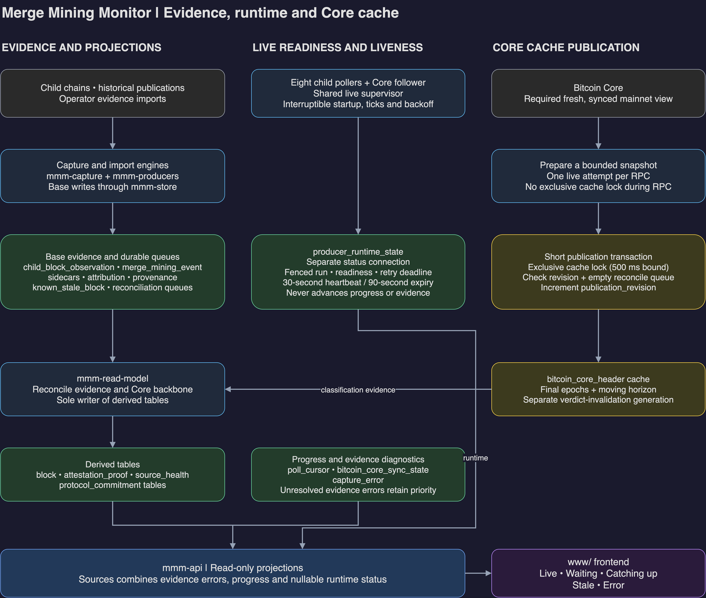

# Architecture

`merge-mining-monitor` is a Rust/Postgres service that collects Bitcoin mining evidence from merge-mined AuxPoW child chains, live Bitcoin Core observations, and recovered historical datasets. It covers stale/orphan and consensus-invalid headers, pool attribution and coinbase protocol declarations.
It turns heterogeneous source evidence into normalized base observations, then derives a read model for the API and frontend.

## System Flow

<p align="center">
  
</p>

The [editable diagram](img/system-data-flow.drawio) shows the same ownership model as the text below: producers capture base evidence, the read-model reconciler is the only writer of derived tables, and the API serves those derived projections without writing capture state.

```text
1. CAPTURE: mmm-capture authenticates; mmm-store writes base evidence
   child RPC / REST or pinned Research publication
       -> child_block_observation + child_miner_identity
       -> linked merge_mining_event for Bitcoin-relevant evidence
          + chain sidecars, attribution and historical provenance
   near shares and blocks without a Bitcoin parent -> observations only
   producer state -> cursors, capture_error, child_chain_head, reconcile queues
   live supervisor -> producer_runtime_state (separate status connection)
   operator membership import -> known_stale_block

2. RECONCILE: mmm-read-model is the sole derived-table writer
   base evidence + known-stale membership + pinned invalid-block catalogue
       + Bitcoin Core context / backbone sync
       -> block, attestation_proof, source_health, protocol_commitment tables,
          relationship_summary
   durable historical, Core and relationship queues drain in bounded transactions

3. SERVE: mmm-api reads Postgres, with no node RPC calls
   derived tables + observation details + capture/runtime status + Core cache
       -> read-only API -> static www/ frontend
```

1. **CAPTURE (`mmm-capture`, `mmm-producers`, `mmm-store`)**: Offline parsers authenticate child-chain proofs and the Bitcoin lineage gate refuses non-Bitcoin SHA-256 parents before storage (`docs/capture.md`).
   Producers and importers write only base evidence (`child_block_observation`, `child_miner_identity`, linked `merge_mining_event`, sidecars, `event_pool_attribution`, `historical_event_provenance`, `known_stale_block`) plus producer operational state (`poll_cursor`, `capture_error`, `child_chain_head`, `producer_runtime_state`) and durable reconcile queues (`docs/historical-ingest.md`).
2. **RECONCILE (`mmm-bitcoin-core`, `mmm-read-model`)**: `mmm-read-model` is the sole writer of derived tables (`block`, `attestation_proof`, `source_health`, the `protocol_commitment` tables decoded from stored Bitcoin coinbase outputs, and `relationship_summary`, each block's stored mixed-signals summary).
   It combines base evidence, `known_stale_block` exclusion gates, the pinned invalid-block catalogue, and Bitcoin Core classification / suffix replacement, draining `historical_reconcile_queue`, `bitcoin_core_reconcile_queue` and `relationship_refresh_queue` in bounded transactions (`docs/data-model.md`).
3. **SERVE (`mmm-api`)**: The read-only HTTP server projects the derived tables, `capture_error` and live runtime status, and the persisted Core-header cache to `/api/v1/*` and serves the static `www/` frontend without calling Bitcoin Core RPC.

## Crates

| Crate | Role |
|---|---|
| `mmm-pg` | Postgres connection configuration. No domain SQL. |
| `mmm-capture` | Offline parsing, normalization, pool resolution, source registry, the Bitcoin lineage rule with its nBits and orphan helpers, and the relationship-signal rule shared by the API and the read model. No network or database I/O in normal builds. |
| `mmm-rpc` | Shared HTTP transport policy for child-chain clients. |
| `mmm-bitcoin-core` | The only crate that links `corepc-client`; wraps Bitcoin Core RPC and parent classification. |
| `mmm-store` | SQL for producer base tables: child observations and identities, events, sidecars, attribution, cursors, capture errors, runtime status, the relationship refresh queue, and seed helpers. It also exposes the read-only Core-header-cache loader shared by reconciliation and the API. |
| `mmm-read-model` | Sole writer of derived tables: `block`, `attestation_proof`, `source_health`, the `protocol_commitment` tables, and `relationship_summary`. Owns the shared capture seam (`capture_in_txn`) and its Bitcoin lineage gate. |
| `mmm-producers` | Runtime engines: chain pollers/backfills, historical importer, Bitcoin Core backbone sync, and pool reclassification. The shared live supervisor owns readiness, recovery and shutdown. |
| `mmm-api` | Read-only API views plus static frontend serving. |
| `merge-mining-monitor` | CLI wiring, generator binaries, and cross-crate integration tests. |

## Repository Layout

```text
crates/            # Rust workspace members (see the crate table above)
data/              # committed release-domain data
                   #   (pools/, consensus/, sources/, findings/, historical/)
migrations/        # schema baseline (0001_), generated source seed (0002_), and forward migrations
fixtures/          # shared JSON API fixtures and per-chain parser samples
www/               # static frontend served by the read API (index.html, css/, js/, vendor/, assets/)
docs/              # this documentation set
scripts/           # migrate-safe, research-pin and catalogue generators,
                   # historical-source manifest checks, arch-lint, live-test helper
compose.yaml       # Postgres 16 (docker compose v2)
justfile           # db, build, test, lint, serve, sync, poll, and backfill targets
```

## Boundaries

- Producers do not write derived tables.
- `mmm-api` does not import producer internals.
- `mmm-api` may read the persisted Core-header cache through `mmm-store`; it never calls Core RPC.
- Bitcoin Core access is isolated in `mmm-bitcoin-core`.
- Hash byte order follows rust-bitcoin newtypes: store `to_byte_array()` bytes directly and use display/RPC hex only at presentation boundaries.
- Adding a Namecoin-family source should extend the source registry and shared producer path, not clone a sibling chain module.

## Public Interfaces

- CLI commands are exposed by `crates/merge-mining-monitor/src/main.rs` and documented through `justfile`.
- Runtime API behavior is documented in `docs/api-contract.md`.
- Product and UI behavior live in `docs/ui-model.md`.
- Generated source metadata is owned by `crates/mmm-capture/src/source_registry` and emitted into `migrations/0002_seed_sources.sql` and `www/js/source-registry.generated.js`.
- The generated findings corpus is owned by `crates/mmm-capture/src/findings_registry/mod.rs`, which validates the hand-authored `data/findings/` files and emits `www/js/findings.generated.js`.
- Strict classic AuxPoW authentication is owned by `mmm-capture::auxpow`; the producer family spec independently selects RPC dialect, raw proof authentication, and capture-failure policy.
