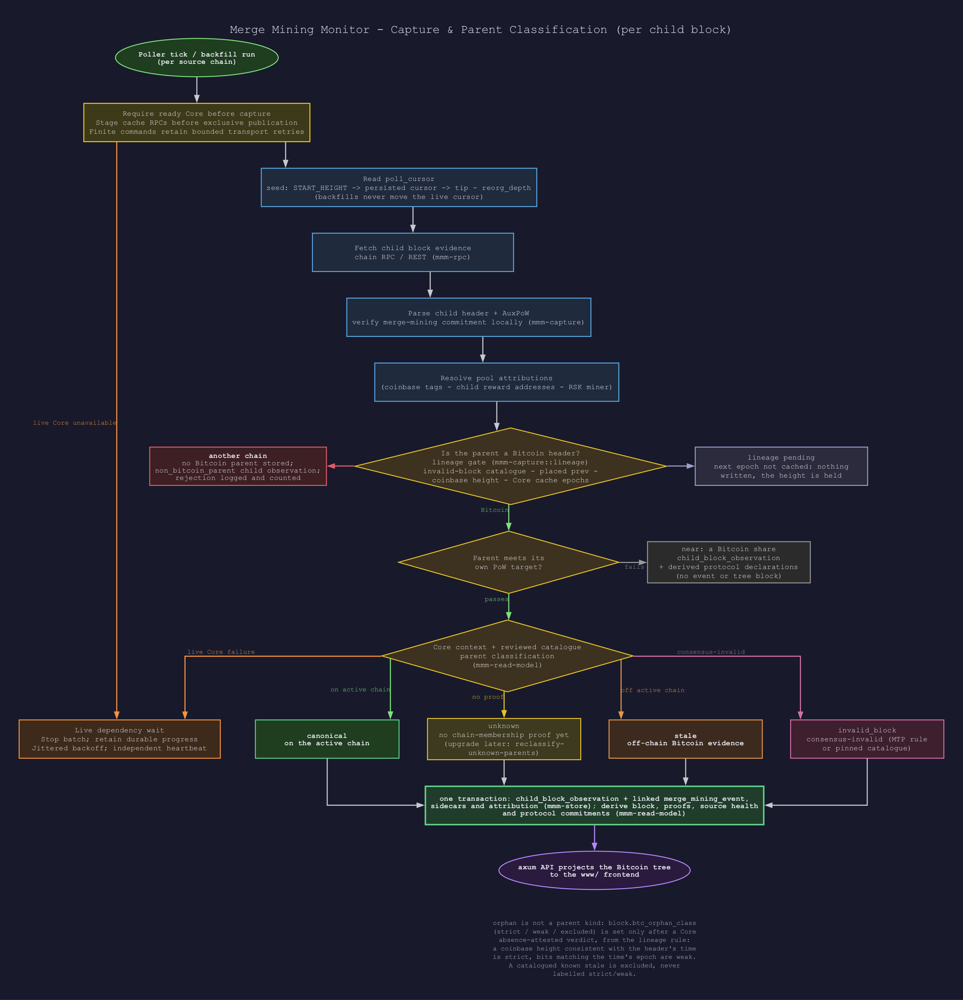

# Capture Sources

Every source follows the same high-level contract: fetch child-chain evidence, verify enough of it locally to make it safe to store, store authenticated child evidence in `child_block_observation`, attach a `merge_mining_event` only for Bitcoin-relevant evidence, and let the read model derive Bitcoin tree state.
Every child block a producer can identify also gets a `child_block_observation` row, so the table shows each chain's full block cadence: event-backed blocks in the event's transaction, blocks without AuxPoW as `not_merge_mined`, blocks with a non-Bitcoin parent as `non_bitcoin_parent`, and blocks whose own identity checks out but whose AuxPoW proof is malformed or incomplete (including RSK blocks without a complete parent header) as `unverified_parent` (see `docs/data-model.md`).
Only blocks that fail their own checks get no row: a hash, height or header the producer cannot authenticate, a Hathor hash that misses its declared weight, an Elastos parent below the child target, and Hathor voided blocks (not on Hathor's best chain).
Older history is filled by backfill rather than left out. Migration 0033 writes an observation for every existing event and for each bitcoind-family block without AuxPoW or with a refused parent that still had a `child_chain_head` row (height and hash only, since the head keeps no block time). `just backfill-CHAIN START END` runs the full per-height capture path, so it records the rest (Elastos and Hathor nears and blocks without AuxPoW, and blocks from before live capture began) and fills missing child fields on existing rows in place. Chains whose nodes are gone arrive through Research block inventory imports.
Child height, hash, header, time, and `nBits` are independent optional evidence; unavailable values remain `NULL`.

## Capture And Classification Flow

  

The [Graphviz source](img/capture-classification-flow.dot) is kept with the rendered diagram.

For a live child block, the poller advances from cursor selection to source fetching, AuxPoW parsing and pool attribution.
The capture then passes the [Bitcoin lineage gate](#bitcoin-lineage-gate): a parent that is not a Bitcoin header is never stored.
Parent classification starts with the parent's own target and Bitcoin Core placement.
Target failures become `near`, which only the child block's observation records (a near has no event); Core-known parents become `canonical` or `stale`.
For a Core-absent target-valid parent with a known predecessor, the classifier verifies its expected `nBits` and reads the exact eleven linked predecessor headers to apply Bitcoin's median-time-past rule.
A timestamp at or below that median becomes `error_block` with the `time_below_mtp` reason.
The pinned consensus-invalid catalogue remains the fallback for rules not yet derived live, and cross-checks a live MTP verdict when both are available.
Its legacy `median_time_past_violation` evidence token is semantically equivalent to `time_below_mtp`; matching live classifications retain the catalogue token.
An incomplete MTP window stays `unknown`, never an orphan.
Other Core-absent target-valid parents remain `unknown` until a later `reclassify-unknown-parents` pass can upgrade them.
BTC orphan status is a later refinement of Core-absent `unknown` parents, not a separate parent kind, and it is gated by the operator-imported `known_stale_block` membership: a header catalogued as a known stale is `excluded` from strict/weak orphan classification rather than overclaimed.

## Bitcoin Lineage Gate

Merge mining lets a child chain commit to any SHA-256 parent, and a proof that verifies says nothing about whether the parent is a Bitcoin header.
Bitcoin Cash blocks and shares, and other SHA-256 chains' blocks, verify just as well; most of Terracoin's parents are Bitcoin Cash headers.
Every live capture therefore passes one gate in the shared seam, `mmm_read_model::capture_in_txn`, before classification or any Bitcoin Core call.
It decides from local evidence under the shared Core-cache lock the capture already holds, using the rule in `mmm_capture::lineage`:

1. A header in the pinned error catalogue is Bitcoin's (block 717,696 kept the previous epoch's bits by design).
2. A prev the Monitor has placed (a canonical, stale or error block, or the Core cache's tip): a share is Bitcoin's whatever its bits, since pool templates briefly keep the previous epoch's bits across a retarget; a block must carry the epoch bits for the prev's height plus one.
3. A strict BIP34 coinbase height consistent with the header's time must carry that height's epoch bits.
   A height outside the epoch the time selects falls to the next step, since another chain's heights run ahead of Bitcoin's.
4. Otherwise the bits must match the epoch the header's time selects or a neighbour.
   A header newer than the cache must carry the latest epoch's bits (or, for a share, the previous epoch's).

A verdict that needs an epoch the cache has not reached (a block right after a retarget) is pending, and a coinbase height more than 144 blocks past the cache's tip is another chain's.
A BIP34 mismatch alone never rejects.

The capture returns `Written`, `NotBitcoin` or `LineagePending`.
A foreign parent writes no parent evidence: any event the source already held for that child block is deleted in the same transaction, since a Core-cache change can turn a stored verdict, and only the child block's `non_bitcoin_parent` observation is written.
The producer still records the block as the chain's block at its height with a settled outcome, so a rescan does not capture it again.
A pending parent writes nothing and holds the height: the live cursor stops there until a later tick's cache refresh decides it, and a bounded backfill stops with an error.
Rejections are logged per block and counted on the `poll tick` line (`non_bitcoin`) and in backfill summaries (`non_bitcoin_parent`); nothing about the parent is stored.

The same rule decides the strict/weak orphan class of Core-absent `unknown` parents, which the historical importer relies on: it stores unknown rows only with a strict or weak verdict, and a pinned publication aborts on any row it would skip.

## Live Sources

| Source | Capture path | Notes |
|---|---|---|
| Terracoin | Raw block RPC: `getblock <hash> false`. | Shared classic parser; mainnet genesis, chain ID 50 on the child and not on the parent (strict chain IDs), child height/hash, commitment and child target checks. Activation 833,000. |
| Namecoin | Core-style raw block RPC: `getblock <hash> 0`. | Namecoin-family AuxPoW parser. |
| Syscoin | Core-style raw block RPC: `getblock <hash> 0`. | Same shared parser as Namecoin, with Syscoin activation/version gates. |
| Fractal Bitcoin | `getblockheader <hash> false true` for `[header][CAuxPoW]`, plus child block data when needed. | Fractal raw blocks do not carry inline CAuxPoW. |
| RSK | Ethereum-style RSKj JSON-RPC for canonical blocks and uncles. | Stores RSK proof sidecar data and miner beneficiary identity. |
| Hathor | Public REST API plus Hathor RFC 0006 merged-mining reconstruction. | No self-hosted mainnet node assumption; reward outputs are parsed from persisted funds graph data. |
| Elastos | JSON-RPC `getblockbyheight`. | Reconstructs the 84-byte child header and verifies the AuxPoW commitment. |
| Qbit | Core-style raw block RPC: `getblock <hash> 0`, whose proof and child transaction body are verified. | Qbit's extended header is not a classic CAuxPoW and has no `hashBlock` field, so it uses the dedicated Qbit decoder and is projected straight into normalized evidence. |
| Bitcoin Core | `sync-bitcoin-core`. | Writes canonical backbone headers and coinbase evidence for tree browsing; follow mode atomically repairs bounded near-tip or lagged-cursor reorg suffixes and retains the displaced side as stale evidence. |

RSK replays may refine the block's chain role and optional proof fields, but an existing sidecar's merge-mining hash, proof format, and any two non-null optional proof values must remain compatible, and the block's observation keeps the one miner its hash commits to; a contradictory replay fails the whole capture transaction.
Hathor live capture requires the reconstructed parent transaction to be a coinbase before accepting its input script, retains the full transaction for strict BIP34 validation (older script-only rows stay weak until replay/import supplies the full transaction), and can promote a matching height-only historical observation to exact child-hash identity in place.

## Polling, Rescans, And Child Displacement

Live pollers use `poll_cursor` (not `MAX(child_height)`) as progress state, seeded in order: (1) explicit `<PREFIX>_START_HEIGHT`, (2) persisted cursor, or (3) `tip - reorg_depth`.
Each tick re-observes the `<PREFIX>_REORG_DEPTH` heights ending at and including the persisted cursor (ending at the tip only once caught up), then advances the cursor by up to `<PREFIX>_BATCH_SIZE`.
Every height observation and write runs under a session-level per-height lock so concurrent pollers and backfills serialize cleanly and record the latest chain head in `child_chain_head`, which keeps only the rescan window (see `docs/data-model.md`, "Child Displacement").
Backfills (`just backfill-CHAIN START END`) use the same per-height path, are bounded and idempotent over event identity, and never advance `poll_cursor`.

| Producer Family | Rescan & Displacement Policy |
|---|---|
| Bitcoind family (`namecoin`, `syscoin`, `fractal`, `qbit`, `terracoin`) | Records every processed height (AuxPoW in the capture txn, non-AuxPoW/malformed in its own txn; a non-AuxPoW block's `not_merge_mined` observation, and a malformed-proof block's `unverified_parent` observation when its header hashes to the node's block hash, share that txn). Rescan compares one `getblockhash` call against `child_chain_head`: skips full capture when the hash is unchanged with a final outcome and no open `capture_error`, and re-captures when the hash changed or the parent verdict was provisional (`unverified`). |
| Elastos | Fetches the full block via `getblockbyheight`. Records and displaces only when the AuxPoW commitment verified and the parent meets the child target, so an untrusted endpoint cannot displace real events with a fabricated non-merge-mined response. A parent that misses Bitcoin's target is captured as a near through the lineage gate; a block without AuxPoW leaves a `not_merge_mined` observation and one whose AuxPoW does not parse or commit to it an `unverified_parent` observation, each with no `child_chain_head` row. |
| Hathor | Records a verified RFC 0006 block when its declared weight meets the displacement work floor against every block captured at the height ($\le 0.25$ step for a shared-parent 1-deep reorg, or $0.25$ per block across the fork up to `HATHOR_MAX_DISPLACEMENT_FORK_DEPTH = 32`). Rescans re-capture if the hash changed, the verdict is non-final, or a sidecar at the height was added/rewritten (`evidence_marker`). A parent that misses Bitcoin's target is captured as a near through the lineage gate (observation only, no sidecar), a block without AuxPoW leaves a `not_merge_mined` observation from its `/block_at_height` answer (when the answer declares a weight, its hash must meet it), and a version-3 block whose reconstruction or parent coinbase is malformed leaves an `unverified_parent` observation the same way. Each sets the head under the same floor where a block was captured at the height; where none was, only while no event is stored there, so a REST answer can displace observations but never Bitcoin-relevant evidence. Voided and archive-cache (`backfill-hathor-cache`) blocks record no head and never revoke events. |
| RSK | Multi-block heights (canonical + uncles) by design; re-captures its `reorg_depth` window in full without writing `child_chain_head` or `child_displaced_*`. |

RSK's live acquisition floor of 139,999 records the historical capture boundary; explicit bounded backfills can start below it, evaluating canonical blocks and each listed uncle independently against the Bitcoin target (`near` when failing the Bitcoin target; `canonical_non_bitcoin` / `uncles_non_bitcoin` when refused by the lineage gate; `canonical_no_parent_header` / `uncles_no_parent_header` when lacking a complete 80-byte parent header, each kept as an `unverified_parent` observation with its RSK facts).

### Malformed Proofs And Capture Failure Policy

Each chain's `FamilySpec::failure_policy` (`CaptureFailurePolicy`) owns malformed-proof handling, operational-failure retention, and same-height clearing without demoting prior evidence:

- **Skip malformed (`namecoin`, `syscoin`, `fractal`)**: logs a proof that fails to decode and continues; the interval is still reported complete.
- **Hold malformed (`qbit`) / hold any height failure (`terracoin`)**: persists a `capture_error` row (`malformed_auxpow_proof` or, for Terracoin, `height_capture_failed`) **before** returning from the failing height.
  A new live height holds the cursor and retries every tick; a rescanned height continues while keeping the `capture_error` row visible; a bounded backfill over a range with an unresolved row exits non-zero.
  The row clears only when that same height is reprocessed successfully, and `/api/v1/sources` surfaces the lowest unresolved height as `sync.error_code = auxpow_capture_error`.

## Shared Producer Rules

- Namecoin-family chains extend the shared chain spec, RPC verbosity, and `mmm-capture::auxpow::parse_verified_classic_block` path rather than cloning chain modules; producers own endpoint checks and persistence without decoding wire layouts.
- Qbit authenticates the child transaction body against its merkle root and checks the chain-native coinbase height before retaining child coinbase evidence, matching pool tags, and resolving authenticated outputs through the child payout registry without another node call.
- Producers write base evidence, sidecars, and producer operational state only; they never write `block`, `attestation_proof`, or `source_health` directly (see `docs/data-model.md`, `docs/historical-ingest.md`, and `docs/operations.md`).
